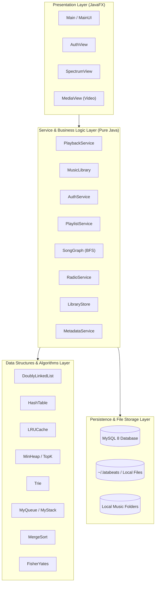
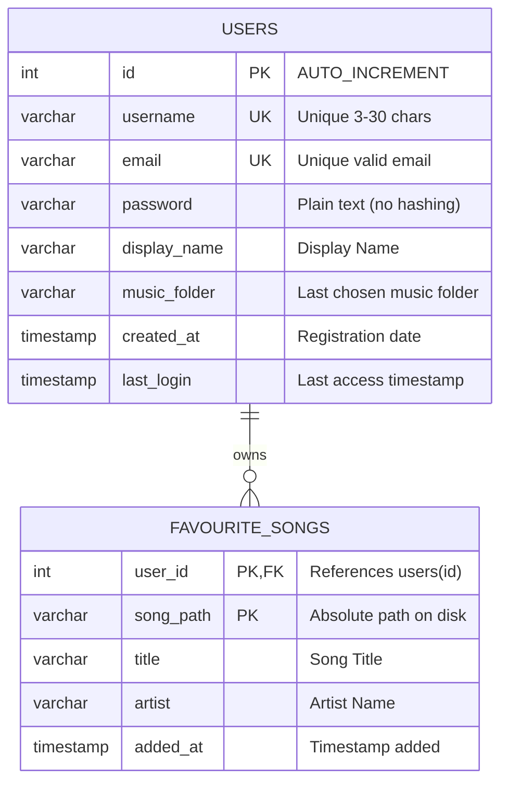

# LataBeats - Advanced DSA Audio & Video Player


> A modern, high-performance desktop music and video player engineered from the ground up to demonstrate real-world **Data Structures and Algorithms (DSAA)**, clean object-oriented architecture (Single Responsibility Principle), zero-dependency low-level binary audio/video tag parsing, and secure relational database persistence.


---

## Table of Contents

1. [Project Overview](#project-overview)
2. [Key Highlights & Features](#key-highlights--features)
3. [Data Structures & Algorithms (DSAA) Blueprint](#data-structures--algorithms-dsaa-blueprint)
4. [System Architecture](#system-architecture)
5. [Database Design & Security](#database-design--security)
6. [Metadata Engine & Binary Parsers](#metadata-engine--binary-parsers)
7. [Installation & Getting Started](#installation--getting-started)
8. [Configuration & Environment Variables](#configuration--environment-variables)
9. [Project Directory Layout](#project-directory-layout)
10. [Controls & Keybindings](#controls--keybindings)

---

## Project Overview

**LataBeats** is an audio and video workstation designed to demonstrate how core computer science concepts directly power responsive, real-time user experiences. Rather than relying on generic black-box utility libraries, LataBeats implements its own **custom separate-chaining Hash Table**, **Trie**, **Min-Heap (Top-K)**, **LRU Cache**, **Doubly Linked Lists**, **Graph Breadth-First Search (BFS)**, **Merge Sort**, **Fisher-Yates Shuffle**, and **binary MP3/MP4/WAV tag parsers**.

The application pairs a glassmorphic JavaFX user interface with a background service architecture that decouples UI rendering from file I/O, relational database synchronization, and playback orchestration.

---

## Key Highlights & Features

### 🎧 Audio & Video Playback Engine

* **Universal Media Support**: Plays **MP3**, **WAV**, **M4A**, and **MP4 / M4V** media.
* **Integrated Video Player**: When playing MP4 music videos, the video stream renders directly inside the right visualizer panel.
* **Pop-Out Video Window**: Double-clicking the video or visualizer opens a dedicated, resizable detached video stage (`MediaView`) for full-screen viewing.
* **Live Audio Spectrum Visualizer**: Real-time 128-band frequency analyzer rendered on a hardware-accelerated Canvas with three selectable visual modes: *Bars*, *Mirror*, and *Dots*. Visualizer colors dynamically morph according to the track's mood.

### 🧭 Four Dedicated Navigation Views

1. **Listen Now**:
   * **Recently Played**: Instant recall of the last 8 played tracks powered by an $O(1)$ **LRU Cache**.
   * **Most Played**: Dynamic leaderboard of the user's top 10 most-played songs maintained by an $O(N \log K)$ **Min-Heap**.
2. **Moods**:
   * Filter and queue music by emotional mood chips (*Late night*, *Energised*, *Calm*, *Dreamy*, *Melancholy*, *Soulful*).
   * Live listening analytics displaying time-weighted mood distribution.
3. **Library**:
   * Multi-criteria filtering: **All Songs**, **Favourites**, **Up Next Queue**, and **Custom Named Playlists**.
   * Multi-column stable sorting using custom **Merge Sort** (Date Added, Title, Artist, Duration, Play Count, Mood).
   * Prefix autocomplete and multi-keyword search powered by a **Trie**.
4. **Radio**:
   * Infinite continuous play stations (*All Songs*, *Favourites*, *Discover*, and mood-specific stations) shuffled via **Fisher-Yates**.

### 🕸️ Graph-Based Recommendation ("More Like This")

* Constructs an in-memory **Undirected Graph** of songs where vertices represent tracks and edges represent shared attributes (same artist, same album, or same mood).
* Right-clicking any song and selecting *"More like this (BFS)"* executes a **Breadth-First Search** traversal, recommending closely related songs in increasing topological distance.

### 📂 Custom Named Playlists

* Create, rename, and delete custom playlists.
* Each playlist is modeled as an independent **Doubly Linked List** indexed in a custom **Hash Table**.
* Playlists, mood tags, play counts, and recently played songs are automatically persisted across sessions via `LibraryStore`.

---

## Data Structures & Algorithms (DSAA) Blueprint

| Feature                         | Data Structure / Algorithm           | Source File                                        | Time Complexity                            | Space Complexity    | Rationale & Mechanism                                                                                                                                         |
| :------------------------------ | :----------------------------------- | :------------------------------------------------- | :----------------------------------------- | :------------------ | :------------------------------------------------------------------------------------------------------------------------------------------------------------ |
| **Active Playlist & Traversal** | **Doubly Linked List**               | `ds/DoublyLinkedList.java` `service/Playlist.java` | $O(1)$ Prev / Next $O(1)$ Insert/Delete    | $O(N)$              | Allows bidirectional song traversal (`next()` / `prev()`), constant-time insertion/removal, and circular looping without array shifting overhead.             |
| **Track & Playlist Index**      | **Hash Table** *(Separate Chaining)* | `ds/HashTable.java`                                | $O(1)$ Average Get/Put $O(N)$ Worst Case   | $O(N)$              | Custom array-of-linked-lists implementation with $0.75$ load factor and automatic resizing ($2\times$) for $O(1)$ path-to-song and name-to-playlist mappings. |
| **Recently Played History**     | **LRU Cache**                        | `ds/LRUCache.java`                                 | $O(1)$ Get $O(1)$ Put                      | $O(C)$              | Combines custom `HashTable` with a doubly linked list to evict least-recently-played items in constant time once the cache reaches capacity (8 items).        |
| **Most Played Top 10**          | **Min-Heap (Top-K)**                 | `ds/MinHeap.java` `algo/TopK.java`                 | $O(N \log K)$ Time                         | $O(K)$              | Array-backed binary min-heap maintaining the top $K=10$ songs by play count, avoiding full $O(N \log N)$ sorting of the entire library.                       |
| **Back History Navigation**     | **LIFO Stack**                       | `ds/MyStack.java`                                  | $O(1)$ Push / Pop                          | $O(H)$              | Tracks player navigation history so pressing "Back" always returns to the previously played song without infinite loops.                                      |
| **Up Next Play Queue**          | **FIFO Queue**                       | `ds/MyQueue.java`                                  | $O(1)$ Enqueue / Dequeue                   | $O(Q)$              | Linked list queue supporting FIFO playback staging and front-of-queue priority insertion ("Play next").                                                       |
| **Live Instant Search**         | **Trie (Prefix Tree)**               | `ds/Trie.java`                                     | $O(L)$ Search / Insert *(L = word length)* | $O(M \cdot \Sigma)$ | Multi-way tree indexing every word in song titles and artists; prefix query returns matching subtrees and intersects matches across multiple search terms.    |
| **Song Recommendations**        | **Graph BFS Traversal**              | `service/SongGraph.java`                           | $O(V + E)$ Traversal                       | $O(V + E)$          | Undirected graph connecting songs with identical artist, album, or mood. Executes Breadth-First Search using `MyQueue` to recommend nearest neighbors.        |
| **Library Column Sorting**      | **Merge Sort**                       | `algo/MergeSort.java`                              | $O(N \log N)$ Time *(Best, Avg, Worst)*    | $O(N)$              | Stable divide-and-conquer sorting algorithm ensuring that tracks with identical sort keys preserve their original date-added insertion order.                 |
| **Radio & Shuffle Queue**       | **Fisher-Yates Shuffle**             | `algo/Shuffle.java`                                | $O(N)$ Time                                | $O(1)$ Aux          | Produces an unbiased random permutation of the song list in a single pass, guaranteeing uniform distribution for radio stations and shuffle mode.             |

---

## System Architecture

LataBeats strictly follows the **Single Responsibility Principle (SRP)** and a clean separation of concerns:



### Module Responsibilities

| Class / Package | Core Responsibility | JavaFX Dependent? |
| :--- | :--- | :---: |
| `Main` | Entry point. Launches JavaFX runtime safely. | No |
| `ui.MainUI` | Primary GUI controller: layout, event handlers, canvas visualizer. | **Yes** |
| `ui.AuthView` | Login, registration, and database configuration dialogs. | **Yes** |
| `ui.SpectrumView` | Real-time Canvas-based audio spectrum visualizer (128 frequency bands). | **Yes** |
| `service.PlaybackService` | State machine governing play, pause, queueing, shuffle, repeat, and history. | **No** |
| `service.MusicLibrary` | In-memory song catalog managing additions, removals, and indexing. | **No** |
| `service.PlaylistService` | Named playlist registry storing doubly linked lists in custom `HashTable`. | **No** |
| `service.SongGraph` | Graph builder and BFS recommendation engine. | **No** |
| `service.AuthService` | Account validation, rate-limited lockouts, and credential checks. | **No** |
| `service.LibraryStore` | Local snapshot serialization for moods, playlists, play counts, and history. | **No** |
| `service.MetadataService` | Background thread coordination for file tag and duration extraction. | **No** |
| `util.TagReader` | Low-level binary parser for ID3 and MP4 atoms from scratch. | **No** |
| `db.Database` / `DatabaseConfig` | MySQL connection lifecycle and auto-schema provisioning. | **No** |
| `ds.*` & `algo.*` | Independent, testable data structures and algorithm implementations. | **No** |

---

## Database Design & Security

Users and their hearted tracks are stored in MySQL. Audio and video files remain on the local disk; the database only stores the metadata, account credentials, and song file paths.

### Entity-Relationship Diagram



### Security Highlights

* **Plain-text passwords**: No hashing is used; passwords are stored and compared as plain text in the `password` column.
* **SQL Injection Prevention**: All queries use parameterized `PreparedStatement` queries.
* **Brute-Force & Enumeration Protection**:
  * Identical error responses for incorrect usernames and incorrect passwords prevent username harvesting.
  * An account lockout activates for 30 seconds after 5 consecutive failed login attempts.
* **Cascading Integrity**: Deleting a user account cascades to automatically purge associated favorites.

---

## Metadata Engine & Binary Parsers

The metadata engine in `util/TagReader.java` is written completely from scratch in pure Java with **zero third-party libraries**:

* **MP3 (ID3v2 & ID3v1)**:
  * Decodes ID3v2.2, ID3v2.3, and ID3v2.4 headers, syncsafe integers, extended headers, and text frames (`TIT2`, `TPE1`, `TALB`).
  * Extracts embedded album art (`APIC` / `PIC` frames) and supports ID3v1 trailer fallbacks.
  * Computes exact audio duration by walking MPEG frame sync headers (`0xFFE` / `0xFFF`) and factoring sample rates and bitrates.
* **MP4 & M4A (MPEG-4 Part 14 Atoms)**:
  * Recursively walks MP4 ISO base media file format atom trees (`ftyp` $\to$ `moov` $\to$ `udta` $\to$ `meta` $\to$ `ilst`).
  * Parses metadata atoms: `©nam` (title), `©ART` (artist), `©alb` (album), and `covr` (embedded JPEG/PNG album art).
  * Decodes movie header atom (`mvhd`) timescale and duration values.
* **WAV (RIFF Container)**:
  * Parses RIFF `fmt`  chunks and audio data chunks to derive length from sample rate, byte rate, and channel count.
* **Fallback Folder Art**:
  * If embedded album art is missing, the engine scans the song's directory for standard artwork files (`cover.jpg`, `folder.jpg`, `front.png`, etc.).

---

## Installation & Getting Started

### Prerequisites

* **Java Development Kit (JDK) 17 or higher** ([OpenJDK](https://adoptium.net/) or [Microsoft OpenJDK](https://learn.microsoft.com/en-us/java/openjdk/download))
* **Apache Maven 3.9+** ([Download Maven](https://maven.apache.org/download.cgi))
* **MySQL Server 8.0+** ([MySQL Community Server](https://dev.mysql.com/downloads/mysql/))

---

### Step 1: Database Setup

1. Ensure your MySQL server is running (default port `3306`).
2. Create the database and dedicated user in MySQL (or run `database/schema.sql`):

```sql
CREATE DATABASE IF NOT EXISTS latabeats CHARACTER SET utf8mb4 COLLATE utf8mb4_unicode_ci;
CREATE USER 'latabeats'@'localhost' IDENTIFIED BY 'choose-a-password';
GRANT ALL PRIVILEGES ON latabeats.* TO 'latabeats'@'localhost';
FLUSH PRIVILEGES;
```

> *(Note: The application auto-creates all required tables on first startup).*

---

### Step 2: Build the Project

Clone the repository and compile via Maven:

```bash
git clone https://github.com/hemlatachelani/latabeats.git
cd latabeats/musicplayer
mvn clean compile
```

---

### Step 3: Run the Application

#### Option A: One-Click Launcher (Windows)

Double-click the included batch launcher:

```text
run.bat
```

#### Option B: Terminal Command

```bash
mvn javafx:run
```

#### Option C: From Your IDE

* Open the folder as a Maven project in IntelliJ IDEA, Eclipse, or VS Code.
* Run the main method in `musicplayer.Main`.

---

## Configuration & Environment Variables

All database settings are in **`src/main/resources/application.properties`** (they are no longer shown on the login/registration screen):

```properties
db.host=localhost
db.port=3306
db.name=latabeats
db.user=root
db.password=
db.params=
```

Edit the file and restart the app. No environment variables or `~/.latabeats/database.properties` are used any more.

---

## Project Directory Layout

```text
musicplayer/
├── database/
│   └── schema.sql                 # MySQL schema definitions
├── src/
│   └── main/
│       ├── java/
│       │   └── musicplayer/
│       │       ├── Main.java       # Clean application entry point
│       │       ├── algo/           # Custom algorithms
│       │       │   ├── MergeSort.java     # Stable O(N log N) sorting
│       │       │   ├── Shuffle.java       # Fisher-Yates O(N) randomizer
│       │       │   └── TopK.java          # O(N log K) min-heap selector
│       │       ├── db/             # Persistence layer
│       │       │   ├── Database.java         # Connection management & auto-DDL
│       │       │   ├── DatabaseConfig.java   # Reads application.properties
│       │       │   ├── DatabaseException.java# User-friendly error translator
│       │       │   ├── FavouriteRepository.java # Prepared statements for favorites
│       │       │   └── UserRepository.java   # Prepared statements for users
│       │       ├── ds/             # Custom Data Structures
│       │       │   ├── DoublyLinkedList.java # Bidirectional linked list
│       │       │   ├── HashTable.java        # Separate-chaining hash table
│       │       │   ├── LRUCache.java         # Hash table + DLL cache (Recently Played)
│       │       │   ├── MinHeap.java          # Binary priority heap
│       │       │   ├── MyQueue.java          # FIFO linked queue (Play queue / BFS)
│       │       │   ├── MyStack.java          # LIFO linked stack (Back history)
│       │       │   └── Trie.java             # Multi-way prefix tree (Live search)
│       │       ├── model/          # Domain models
│       │       │   ├── Song.java             # Song domain model
│       │       │   └── User.java             # Authenticated user session model
│       │       ├── service/        # Core business rules
│       │       │   ├── AuthService.java      # Registration, login & lockout rules
│       │       │   ├── FavouritesService.java# Background async favorites sync
│       │       │   ├── FileScanner.java      # Recursive audio/video file discoverer
│       │       │   ├── LibraryStore.java     # User library snapshot serializer
│       │       │   ├── ListeningStats.java   # Mood listening-time tracker
│       │       │   ├── LocalSettings.java    # Per-machine user preferences
│       │       │   ├── MetadataService.java  # Async tag extraction service
│       │       │   ├── MusicLibrary.java     # In-memory song collection & Trie index
│       │       │   ├── PlaybackService.java  # Player state, queue, & history coordinator
│       │       │   ├── Playlist.java         # Linked-list playlist
│       │       │   ├── PlaylistService.java  # Named playlists manager
│       │       │   ├── ProfileStore.java     # User avatar & profile picture store
│       │       │   ├── RadioService.java     # Smart shuffled station generator
│       │       │   ├── SongGraph.java        # Song relationship graph & BFS traversal
│       │       │   ├── SortOrder.java        # Sorting criteria enum & comparators
│       │       │   └── Station.java          # Radio station configuration
│       │       ├── ui/             # JavaFX Presentation layer
│       │       │   ├── AuthView.java         # Login & account creation view
│       │       │   ├── MainUI.java           # Main player window & controls
│       │       │   └── SpectrumView.java     # Canvas audio visualizer (128 bands)
│       │       └── util/
│       │           └── TagReader.java        # Zero-dependency binary ID3/MP4/WAV parser
│       └── resources/
│           └── style.css          # Glassmorphic dark theme stylesheet
├── sample_music/                  # Pre-packaged 44.1kHz demo songs
│   ├── A.R. Rahman - Jai Ho (Demo).wav
│   ├── Kishore Kumar - Pal Pal Dil Ke Paas (Demo).wav
│   ├── Lata Mangeshkar - Lag Ja Gale (Demo).wav
│   └── Ludwig van Beethoven - Moonlight Sonata (Demo).wav
├── src/
│   ├── main/
│   │   ├── java/
│   │   │   └── musicplayer/
│   │   │       ├── Main.java       # Clean application entry point
│   │   │       ├── algo/           # Custom algorithms
│   │   │       │   ├── MergeSort.java     # Stable O(N log N) sorting
│   │   │       │   ├── Shuffle.java       # Fisher-Yates O(N) randomizer
│   │   │       │   └── TopK.java          # O(N log K) min-heap selector
│   │   │       ├── db/             # Persistence layer
│   │   │       │   ├── Database.java         # Connection management & auto-DDL
│   │   │       │   ├── DatabaseConfig.java   # Reads application.properties
│   │   │       │   ├── DatabaseException.java# User-friendly error translator
│   │   │       │   ├── FavouriteRepository.java # Prepared statements for favorites
│   │   │       │   └── UserRepository.java   # Prepared statements for users
│   │   │       ├── ds/             # Custom Data Structures
│   │   │       │   ├── DoublyLinkedList.java # Bidirectional linked list
│   │   │       │   ├── HashTable.java        # Separate-chaining hash table
│   │   │       │   ├── LRUCache.java         # Hash table + DLL cache (Recently Played)
│   │   │       │   ├── MinHeap.java          # Binary priority heap
│   │   │       │   ├── MyQueue.java          # FIFO linked queue (Play queue / BFS)
│   │   │       │   ├── MyStack.java          # LIFO linked stack (Back history)
│   │   │       │   └── Trie.java             # Multi-way prefix tree (Live search)
│   │   │       ├── model/          # Domain models
│   │   │       │   ├── Song.java             # Song domain model
│   │   │       │   └── User.java             # Authenticated user session model
│   │   │       ├── service/        # Core business rules
│   │   │       │   ├── AuthService.java      # Registration, login & lockout rules
│   │   │       │   ├── FavouritesService.java# Background async favorites sync
│   │   │       │   ├── FileScanner.java      # Recursive audio/video file discoverer
│   │   │       │   ├── LibraryStore.java     # User library snapshot serializer
│   │   │       │   ├── ListeningStats.java   # Mood listening-time tracker
│   │   │       │   ├── LocalSettings.java    # Per-machine user preferences
│   │   │       │   ├── MetadataService.java  # Async tag extraction service
│   │   │       │   ├── MusicLibrary.java     # In-memory song collection & Trie index
│   │   │       │   ├── PlaybackService.java  # Player state, queue, & history coordinator
│   │   │       │   ├── Playlist.java         # Linked-list playlist
│   │   │       │   ├── PlaylistService.java  # Named playlists manager
│   │   │       │   ├── ProfileStore.java     # User avatar & profile picture store
│   │   │       │   ├── RadioService.java     # Smart shuffled station generator
│   │   │       │   ├── SongGraph.java        # Song relationship graph & BFS traversal
│   │   │       │   ├── SortOrder.java        # Sorting criteria enum & comparators
│   │   │       │   └── Station.java          # Radio station configuration
│   │   │       ├── ui/             # JavaFX Presentation layer
│   │   │       │   ├── AuthView.java         # Login & account creation view
│   │   │       │   ├── MainUI.java           # Main player window & controls
│   │   │       │   └── SpectrumView.java     # Canvas audio visualizer (128 bands)
│   │   │       └── util/
│   │   │           └── TagReader.java        # Zero-dependency binary ID3/MP4/WAV parser
│   │   └── resources/
│   │       └── style.css          # Glassmorphic dark theme stylesheet
│   └── test/java/musicplayer/     # Complete Unit Test Suite (JUnit 5)
│       ├── algo/AlgorithmsTest.java       # MergeSort stability, Top-K, Shuffle tests
│       ├── ds/DataStructuresTest.java     # DLL, HashTable, LRU, Heap, Trie tests
│       ├── service/SongGraphTest.java     # Graph BFS relationship tests
│       └── StandaloneTestRunner.java      # Self-executing CLI test runner
├── EXPLANATION.md                 # Viva voce & technical defense guide
├── pom.xml                        # Maven dependencies & build configuration
├── README.md                      # Comprehensive project documentation
├── run.bat                        # Windows desktop execution script
└── test.bat                       # One-click automated test runner
```

---

## Controls & Keybindings

| Action | Shortcut / Gesture | Description |
| :--- | :--- | :--- |
| **Play / Pause** | `Space` / Click Play button | Toggles audio and video playback |
| **Seek Forward** | `Right Arrow` | Seeks +5 seconds forward |
| **Seek Backward** | `Left Arrow` | Seeks -5 seconds backward |
| **Next Track** | `L` / Click Next button | Advances to the next track in queue/playlist |
| **Previous Track** | `J` / Click Back button | Pops previous track from history stack |
| **Mute Toggle** | `M` | Mutes or restores audio volume |
| **Heart / Favorite** | `H` / Click Heart button | Toggles song in user's favorites in MySQL |
| **Jump to Search** | `Ctrl + F` | Immediately focuses and highlights search box |
| **Clear Search** | `Esc` / Click `✕` | Clears active search filter |
| **Play Song** | Double-click row | Plays selected track immediately |
| **Context Menu** | Right-click row | Options: *Play next*, *Add to queue*, *More like this*, *Add to playlist*, *Set mood* |
| **Cycle Visualizer** | Click Visualizer card | Cycles through *Bars*, *Mirror*, and *Dots* |
| **Toggle Video / Visualizer** | Click card during MP4 | Switches between video stream and spectrum visualizer |
| **Pop-out Video** | Double-click video card | Opens video in a dedicated, resizable detached window |
| **Edit Profile & Photo** | Click user avatar | Opens custom display name & photo dialog |

---

## Academic & Engineering Significance

This project demonstrates:

1. **Practical Algorithmic Engineering**: Applying textbook data structures (Tries, Heaps, Graphs, LRU, DLLs) to solve real UI challenges like sub-millisecond search, recommendation walks, and responsive playback staging.
2. **Low-Level Binary File Parsing**: Direct byte-level stream processing (`RandomAccessFile`) of standard multimedia containers (ID3, MPEG, MP4/M4A atoms, WAV RIFF) without external third-party helper libraries.
3. **Enterprise Defense-in-Depth**: Parameterized queries, and defensive user authentication models.
4. **Clean Code & Modularity**: Strict adherence to the Single Responsibility Principle, loose coupling between components, and testable domain logic.
